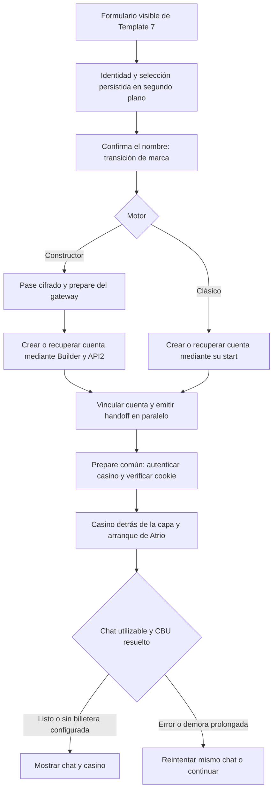

# Transición, respuestas Full Carga y operaciones de Ases

Fecha de trabajo: 20/10/2026, Argentina. Algunas comprobaciones finalizaron el 21/10 UTC. API2 y Panel3 permanecen locales.

## Revisión de los cinco puntos del programador

| Punto | Hallazgo y resultado |
| --- | --- |
| Formulario inicial | Template 7 entrega HTML y CSS crítico inline, fuentes del sistema e imágenes derivadas. La preparación es asíncrona y no crea cuentas antes de confirmar. Las pruebas funcionales permitieron escribir y confirmar con imágenes indisponibles y la consulta de destino retenida. No se realizó una medición nueva de TTFB/paint de producción en este lote. |
| Preparación mientras escribe | El timeout suave podía borrar una promesa de destino todavía pendiente y repetir su consulta. Se conserva ahora tanto la promesa pendiente como un resultado válido. Sólo un resultado fallido se reemplaza. El calentamiento del gateway también se comparte por origen. Ambos motores marcan el inicio para evitar una recuperación de fondo que compita con el envío. |
| Cadena entre servicios | Se conservan vinculación y handoff en paralelo, y se evita `/finalize` cuando ya existe un handoff listo. El clásico muestra la misma transición utilizando su ticket existente, sin otro alta/issuer. En Ases se eliminan navegador, recursos visuales y redirecciones al home de la vía HTTP de Atrio; el formulario de cuenta sigue verificando la autenticación. El receptor de respuestas de API2 agenda push después de responder. |
| Arranque de Atrio | Se mantiene el bootstrap autorizado en servidor y la tarjeta de CBU inicial. El gateway espera el aviso de conversación hidratada y preparación bancaria terminada; no lo sustituye por `iframe.load` o `widget.ready`. Un error deja reintentar el mismo iframe o continuar al chat. Instalación, SDK y push continúan después de la disponibilidad del recorrido. |
| Infraestructura | No se cambiaron regiones, pools de DB ni infraestructura sin evidencia. Se conservan Server-Timing de Template 7 y registros por etapa; Ases agrega tiempos de login, formulario, envío y saldo posterior, junto al ID de operación de API2. La muestra real identifica autenticación y viajes al proveedor como costos relevantes. Redis no se incorpora a este lote. |

## Recorrido y transición

El clásico conserva su identidad y endpoint; su `/start` devuelto se presenta mediante `/prepare` con el mismo ticket. El gateway activa ese ticket una sola vez y no ejecuta `/preparations/complete` ni vuelve a crear la cuenta. El constructor conserva el token `p1` y su creación idempotente. El wrapper visual no modifica atribución, CONTACT, primer mensaje/LEAD, PURCHASE, ownership ni recuperación.

La capa usa logos de cada casino con AVIF/WebP y el tamaño grande aprobado. No tiene tiempo mínimo ni porcentajes simulados. Los eventos se aceptan sólo del origen y `contentWindow` del iframe autorizado. El vencimiento de espera ofrece controles, nunca declara el chat listo por un timer. Ganamos+ recibe las mejoras comunes; no tiene alta real por PBAdmin y no se declara probado ese escenario.

## Configuración de mensajes

Configuración → Bots de PBAdmin → engranaje del bot Full Carga. Modal con procesamiento de archivos, carga, retiro, cuenta/acceso, soporte, conversación, promoción y sin clasificar. Todo está activado por defecto. Desactivar avisos financieros afecta sus mensajes, no sus verificaciones o ejecución; la UI lo aclara.

La preferencia se guarda en la vinculación propia del asesor. La RPC existente registra mensaje o supresión en la misma transacción y bajo la misma clave única. Una supresión devuelve ACK exitoso sin mensaje ni push, y los reintentos conservan esa decisión aunque se reactive la categoría. No se borran mensajes anteriores. MKT, mensajes manuales, chips, bootstrap de CBU y confirmaciones financieras por su endpoint propio no usan este filtro. El cron de reenvíos no selecciona filas omitidas.

API2 desplegado todavía puede enviar mensajes sin descriptor: se agrupan como sin clasificar y permanecen activos por defecto. Publicar este lote local de API2 es necesario para distinguir todas las categorías nuevas.

## Ases: muestra real del adaptador local

| Operación | Muestra anterior | Muestra final |
| --- | ---: | ---: |
| Carga de una ficha | 7,295 s | 2,379 s |
| Retiro de una ficha, con consulta previa | 7,435 s | 2,684 s |
| Saldo del jugador antes/después del ciclo | 500 / 500 | 500 / 500 |

La ejecución HTTP del retiro tardó 1,764 s y su consulta previa 0,920 s. El adaptador de carga confirmó bot, jugador, tipo e importe en la respuesta nativa y verificó saldo 501; el retiro verificó saldo 500. El cálculo de saldo usa nominales decimales exactos. Cada mutación tiene un solo POST, sin redirects ni retries financieros. La sesión de cada operación es aislada. Una incompatibilidad previa al POST permite el navegador anterior; después del envío no hay fallback y se conserva la reserva incierta. Otros canales mantienen su implementación.

Son muestras individuales desde Windows contra el proveedor real. Excluyen la API HTTP completa de API2, su persistencia y el viaje desde Atrio. No son p50/p95 ni garantizan tiempos productivos. Una prueba previa de captura por navegador acreditó una ficha sin completar su captura; se concilió con el historial del proveedor y se restituyó con un retiro verificado. Otra prueba se detuvo antes del POST de retiro al detectar que el formulario no incluía saldo; tras corregir la lectura, se continuó sólo ese retiro no enviado. Los tres ciclos concluyeron con 500 fichas; no se repitió una carga incierta. No hubo transferencias bancarias ni HG, y la operación 13 de Ganamos quedó excluida.

Evidencia numérica y conciliación: `api2/docs/validation/atrio-ases-http-20261020.json`. No hay una migración nueva de API2 por este cambio.

## Validación

- 48 comprobaciones de navegador en Chromium/WebKit: modal y ocho switches, MKT sin engranaje, cancelar/guardar/reabrir/error, teclado, móvil/escritorio/horizontal; cuatro formularios de login con ojo y texto centrado; formulario de ambos motores con destino retenido, una consulta y transición inmediata. APIs simuladas; cero cuentas reales creadas o escrituras productivas en esta suite. Las rutas de Playwright desactivan caché HTTP: estos resultados funcionales no representan tiempos de producción.
- 32 comprobaciones de SDK diferido en los cuatro gateways y ambos motores de navegador, incluidos recursos retenidos del casino. Cuatro comprobaciones adicionales de hidratación sin errores y con hora local preservada.
- Postgres aislado: defaults, supresión por cuenta Full Carga, MKT y APIs generales intactos, archivo/texto, compatibilidad sin descriptor, idempotencia tras cambiar preferencias, seis reintentos concurrentes y rechazo de acceso público/escrituras del cliente.
- Regresiones de identidad, reingreso, preparación y atribución del constructor/clásico. Pruebas de Ases HTTP rechazan confirmación genérica, cuenta/bot/importe incorrectos, saldo contradictorio, respuesta perdida y redirect después de POST. El cliente de API2 acepta una supresión sin exigir `messageId` y no la reintenta.
- Builds/tipado y sincronización de los módulos compartidos. `sync-entry-transition.mjs --check`, `sync-gateway-login.mjs --check`, `sync-gateway-app-sdk.mjs --check` y `build-classic-template7.mjs` verifican sus fuentes comunes.

Artefactos locales del navegador: `landing-builder/.vercel/validation-entry-and-replies/report.json` y `validation-deferred-app`. Son pruebas locales con fixtures; no certifican WhatsApp/iPhone físico. La comprobación manual del usuario y la medición completa en producción corresponden después de publicar API2.

## Publicación

La migración `20261021003939_full_carga_reply_preferences.sql` quedó aplicada antes de habilitar el modal; sus defaults conservan todas las respuestas y el historial. Atrio quedó publicado con el commit `b7869d5`. Los gateways se publicaron antes de los motores de landing: Rey `676862a`, Ases `ea05dc5`, Ganamos NET `4cbb9ed` y multi-skin `da4991f`. Ganamos+ incluye el Worker de Cloudflare, versión `07074fa9-ccd2-44a0-975d-b6b493e0e74d`.

La comprobación pública de los cuatro gateways verificó el hash del JavaScript servido contra su fuente, login y las dos variantes de transición, sin activar tickets ni crear cuentas. Se ejecuta con `node scripts/check-public-entry-release.mjs`. La evidencia de despliegue y comprobación final de ambos motores se guarda en `.vercel/validation-entry-and-replies/release.json`; los artefactos de `.vercel` son locales. API2 y Panel3 no se publican por este lote. La medición completa de tiempos productivos se repite después del despliegue de API2.
